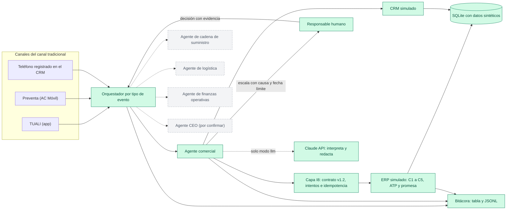
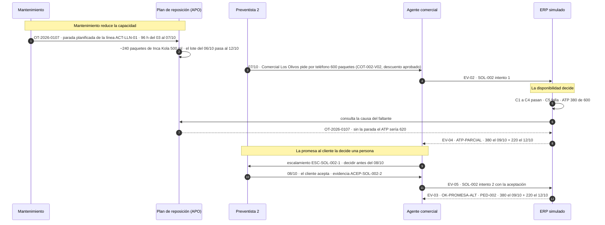
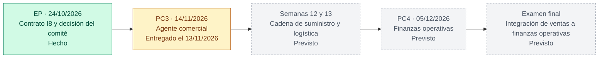

# Agente SIE · Coca-Cola / ACL · GE703 G2

Sistema de agentes de IA, uno por proceso y coordinados por un orquestador, que ejecuta y controla el flujo de un pedido del canal tradicional desde la venta hasta las finanzas operativas.

| | |
|---|---|
| Curso | GE703 Sistemas Integrados Empresariales · UNI / FIIS · 2026-2 |
| Grupo | G2 |
| Empresa | Coca-Cola, a través de Arca Continental Lindley (ACL), Perú · canal tradicional (bodegas que piden por TUALI, preventa o teléfono) |
| Integrantes | Barrionuevo Gutierrez, Salvador Jhou (líder y arquitecto) · Cornejo Palomino, José Julián · Leandro Ochoa, Gianmarco · Urbano Lara, David Alexis · aportes de cada uno en [`arquitectura/ROLES_EQUIPO.md`](arquitectura/ROLES_EQUIPO.md) |
| Incremento actual | PC3: agente comercial · entrega 13/11/2026, exposición 14/11/2026 |

## Qué resuelve

En el examen parcial el comité aprobó **"un pedido, un contrato, tres canales"**: todo pedido del canal tradicional, llegue por TUALI, por preventa o por teléfono, entra al ERP (SAP ECC) por el mismo contrato CRM–ERP (I8), con las mismas cinco validaciones (C1–C5) y una respuesta codificada. El problema de fondo es la adopción de TUALI: cerca del 46 % de los clientes aún no usa la app (cálculo del equipo), y en los pedidos telefónicos el precio, el stock y el crédito se confirman a mano, con promesas que no miran la disponibilidad (hipótesis H1). El Agente SIE pone ese contrato en ejecución: recibe la solicitud, la valida con reglas, consulta la disponibilidad (ATP), responde con el código del contrato y escala a una persona cuando hace falta.

## Arquitectura



Verde: implementado y probado (el modo LLM, con una simulación de la API) · gris punteado: previsto para incrementos siguientes. Detalle: [`arquitectura/VISTAS.md`](arquitectura/VISTAS.md) y decisiones en [`arquitectura/adr/`](arquitectura/adr/).

## Caso de excepción: de la parada de mantenimiento a la promesa al cliente

Este caso une la demo del agente con el informe de la PC3 (activos, mantenimiento y cadena de suministro): una parada planificada reduce la capacidad, la capacidad perdida reduce el ATP y el ATP obliga a una promesa alternativa que solo una persona puede aceptar. Los datos de la parada son sintéticos.



El caso normal sigue el mismo camino sin escalamiento: Bodega Don Lucho (CLI-003) acepta en TUALI la cotización COT-003-V01 → SOL-003 → `OK-ACEPTADO` → PED-003. Cadena completa e indicadores para el informe: [`procesos/PARADA_ATP.md`](procesos/PARADA_ATP.md).

## Hoja de ruta



Todos los incrementos usan los mismos datos: los pedidos PED-002 y PED-003 que crea el agente en la PC3 son idénticos a los del EP, de modo que la PC4 los llevará a entrega, factura, cobro y conciliación.

## Estado del avance al 13/11/2026 (entrega de la PC3)

| Componente | Estado | Evidencia |
|---|---|---|
| Contrato I8 v1.2 tipado | Hecho | `producto/sie/contrato.py` · 8 pruebas (reproduce los 12 mensajes del EP y el catálogo de 9 códigos) |
| Orquestador | Hecho | `producto/sie/orquestador.py` · 8 pruebas · ADR-006 |
| Configuración | Hecho | `producto/sie/config.py` · 6 pruebas · ADR-002 |
| CLI y diagnóstico | Hecho | `producto/sie/cli.py` · 8 pruebas · demo normal 4 de 4 conformes, excepción 8 de 8 |
| Datos y ERP simulado | Hecho | `producto/sie/erp/`, `producto/sie/db/` · 22 pruebas (los 12 intentos del EP y sus 9 pedidos al céntimo) · ADR-004 |
| Agente comercial y bitácora | Hecho | `producto/sie/agentes/comercial/` · 13 pruebas · ADR-003, ADR-005 · ficha en `agentes/comercial/FICHA.md` |
| Modo LLM (Claude API) | Hecho, probado con una simulación de la API | `producto/sie/llm/` · 16 pruebas · ADR-001. Pendiente: prueba con la API real (sin API key) |
| Interfaz (Streamlit) | Hecho | `producto/sie/ui/app.py` · recorrido completo de los dos casos sin errores |
| Paquete de entrega (guía y ZIP) | Hecho | [`entrega/GUIA_DESPLIEGUE.md`](entrega/GUIA_DESPLIEGUE.md) · ZIP verificado desde una copia extraída · 5 pruebas |
| Resultados esperados calculados a mano | Pendiente | `pruebas/CASOS.csv` · Gianmarco Leandro |
| Informe de la PC3 | Hecho | [`docs/entregables_pc3/GE703_PC3_Informe_G2_CocaCola.pdf`](docs/entregables_pc3/GE703_PC3_Informe_G2_CocaCola.pdf) |
| Presentación de la PC3 | Hecho | [`docs/entregables_pc3/GE703_PC3_Presentacion_G2_CocaCola.pdf`](docs/entregables_pc3/GE703_PC3_Presentacion_G2_CocaCola.pdf) (el `.pptx` incluye notas del expositor) |

Total: 84 pruebas automáticas pasan y 1 se omite si Streamlit no está instalado (verificado el 13/11/2026). Evidencia de las demos: [`pruebas/evidencia/`](pruebas/evidencia/) y [`pruebas/ESPERADO_VS_OBSERVADO.md`](pruebas/ESPERADO_VS_OBSERVADO.md). Plan del incremento: [`arquitectura/PLAN_PC3.md`](arquitectura/PLAN_PC3.md).

## Principios de diseño

- **Las reglas deciden; el LLM interpreta.** Un motor de reglas determinista decide C1–C5, el código y la promesa. El LLM solo entiende el texto del pedido con herramientas de lectura y redacta la explicación; una cifra redactada que no esté en los hechos se descarta (ADR-001).
- **El agente envía; solo el ERP crea pedidos.** El agente manda la solicitud (EV-02) por la interfaz I8, pero nunca crea pedidos, aprueba descuentos ni confirma una promesa sin una decisión humana (ADR-003).
- **Se ejecuta sin dependencias ni API key.** La demo usa solo Python 3.11 y SQLite; Streamlit, la Claude API y pytest son opcionales (ADR-002).
- **Todo queda en la bitácora, con escalamiento humano.** Cada paso se guarda con regla, código, IDs, fecha de negocio y, si se escala, a quién, por qué y hasta cuándo (ADR-005).

## Cómo probarlo

Requisito: Python 3.11 o superior; no hace falta instalar nada más. Guía completa, con resultados esperados y recuperación ante fallos: [`entrega/GUIA_DESPLIEGUE.md`](entrega/GUIA_DESPLIEGUE.md).

```powershell
cd producto
python -m sie diagnostico         # verifica el entorno
python -m sie demo normal         # Don Lucho por TUALI → OK-ACEPTADO → PED-003
python -m sie demo excepcion      # Los Olivos por teléfono → ATP-PARCIAL → decisión de Preventista 2 → PED-002
python -m sie bitacora --run <run>  # bitácora del caso
python -m sie ui                  # interfaz web (requiere pip install -r requirements.txt)
```

Cada demo termina con una tabla de resultado esperado frente a observado. Pruebas automáticas, desde la carpeta raíz: `pip install -r requirements.txt` y `python -m pytest pruebas`.

## Estructura del repositorio

| Carpeta | Contenido |
|---|---|
| `arquitectura/` | Plan del incremento, roles del equipo, vistas, interfaces, versiones, decisiones (ADR) y contrato I8 v1.2 |
| `procesos/` | Modelo del proceso, reglas y tabla de decisiones, eventos, controles y la cadena parada → ATP → promesa |
| `datos/` | Diccionario de datos, fuentes, datos de prueba (`seed/`) y tratamiento de datos sensibles |
| `producto/` | Código del Agente SIE (paquete `sie`): orquestador, agentes, reglas, ERP y CRM simulados, CLI e interfaz |
| `pruebas/` | Pruebas automáticas, evidencia de las demos, esperado frente a observado, incidencias y criterios de aceptación |
| `fuentes/` | Bibliografía, licencias y declaración de uso de IA |
| `agentes/` | Ficha de cada agente: propósito, entradas, salidas, reglas, permisos, escalamiento y bitácora |
| `entrega/` | Guía de despliegue y script que arma y verifica el ZIP de entrega |
| `docs/` | Antecedentes del EP, la PC3 y la PC4 (solo lectura), el esqueleto del informe y los entregables de la PC3 (`docs/entregables_pc3/`: informe y presentación) |

## Datos

Todos los datos son **sintéticos** o vienen del modelo del examen parcial, que también es sintético: clientes marcados "(sintético)", correos `@example.com`, teléfonos `SIM-TEL-…` y documentos `SIM-RUC…`. Precios, stocks, créditos, políticas y la parada de mantenimiento son supuestos didácticos, no datos de ACL. No hay datos personales. El repositorio no contiene contraseñas ni API keys: la configuración se copia de `.env.example` a un `.env` local que git no versiona.

## Preguntas abiertas al docente

1. ¿Cumple como "agente de IA" un diseño en el que las reglas deciden y el LLM solo interpreta el pedido y redacta la explicación?
2. ¿Cómo prefiere ejecutar el modo LLM: con su propia API key, solo en modo reglas (sin clave) o con un acceso temporal que le proporcionemos?
3. ¿Acepta que el ERP (SAP ECC) y el CRM (SAP Sales Cloud) estén simulados sobre SQLite con datos sintéticos?
4. Para el examen final, ¿se exige un agente CEO o un orquestador más avanzado, o el alcance termina en finanzas operativas?

## Licencia

Código bajo licencia MIT (`LICENSE`). El material del curso en `docs/antecedentes/` pertenece a la UNI FIIS (GE703) y se incluye solo para revisión académica. Uso de IA declarado en [`fuentes/DECLARACION_IA.md`](fuentes/DECLARACION_IA.md).
