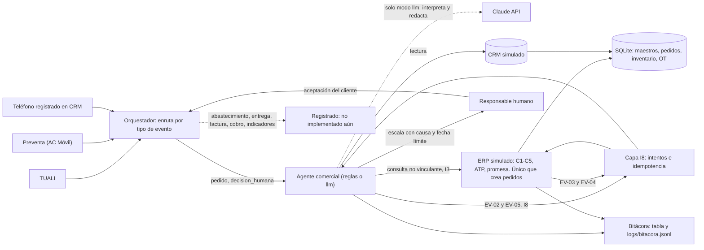

# Plan del incremento PC3 · Agente SIE · G2 · Coca-Cola / ACL

**Estado:** aprobado por Salvador Barrionuevo el 07/11/2026 · **Versión:** 1.1 (cambio de reparto, §2 y §9)
**Entrega:** viernes 13/11/2026, 17:00 (aula virtual) · **Exposición:** sábado 14/11/2026

Este documento es la referencia común del equipo. Los aportes de cada integrante están en `arquitectura/ROLES_EQUIPO.md`.

## 1. Qué pide la PC3 y qué condiciona

| Requisito (instrucciones de la PC3) | Cómo lo cubrimos |
|---|---|
| Tres entregables: presentación PDF, informe PDF y `GE703_PC3_Agente_G2_CocaCola.zip` | El ZIP lo arma `entrega/armar_zip.py`; los PDF los prepara el equipo fuera del código |
| Exposición de 15 min: 10 de presentación **y demo**, 3 de preguntas, 2 de retroalimentación | La demo completa (normal + excepción) debe caber en menos de 3 minutos |
| El docente elige **dos integrantes al azar** | Todos deben saber ejecutar la demo y explicar reglas, controles, trazabilidad y escalamiento |
| Informe: activos y mantenimiento, cadena de suministro I, relación mantenimiento → disponibilidad → continuidad | La parada sintética de la línea de llenado (§5.3) es el caso del informe y la causa del ATP reducido de la demo |
| Guía del paquete: propósito, entradas, salidas, fuentes, herramientas, reglas, permisos, responsable humano, escalamiento y bitácora | `agentes/comercial/FICHA.md`, enlazada desde `entrega/GUIA_DESPLIEGUE.md` |
| Datos de prueba con esperado y observado; requisitos, dependencias y variables | `pruebas/` y la guía; la CLI imprime esperado frente a observado al final de cada demo |
| El docente debe poder ejecutarlo con los archivos entregados; diagnóstico y recuperación | Núcleo sin dependencias externas, `python -m sie diagnostico` y sección de recuperación en la guía |
| Datos sintéticos identificados con supuestos, unidades y rangos; sin contraseñas | Diccionario con columnas de unidad, rango y origen; `.env.example`; búsqueda de secretos al armar el ZIP |

**PC4 (entrega 04/12, exposición 05/12):** cadena de suministro y logística integradas con finanzas operativas, **con los mismos datos del proyecto**. Los agentes adicionales son opcionales y deben justificarse. El diseño de datos de §5.4 ya lo contempla.

## 2. Decisiones aprobadas

| # | Decisión | Dónde queda |
|---|---|---|
| 1 | **v1.1 (07/11):** Salvador implementa los cuatro bloques con asistencia de IA declarada; los demás integrantes tienen aportes verificables no técnicos. *(v1.0: cada integrante implementaba su bloque a partir de un brief; se reemplazó para asegurar calidad y plazos.)* | `arquitectura/ROLES_EQUIPO.md` |
| 2 | Parada sintética: ACT-LLN-01, OT-2026-0107, 96 h, −240 paquetes de PRD-001 | §5.3 |
| 3 | El agente envía EV-02 y EV-05 por I8; **solo el ERP simulado crea pedidos** | ADR-003 |
| 4 | Una sola confirmación humana en la demo: Preventista 2 registra la aceptación del cliente (EV-05) | ADR-005 |
| 5 | Si la cotización no puede enviarse, el agente devuelve el resultado interno `NO-ENVIADA` (regla R2); el catálogo del contrato no cambia | ADR-005 |
| 6 | La demo en vivo corre en modo `reglas`. El modo `llm` se prueba con una simulación de la API y se declara así mientras no haya API key | ADR-001 |
| 7 | `docs/antecedentes/` se versiona; la carpeta larga se renombró a `docs/antecedentes/repo_ep_v3/` | — |
| 8 | Agente CEO: registrado en el orquestador como no implementado; Salvador lo consulta con el docente | ADR-006 |

## 3. Contrato I8 (resumen)

Fuente: contrato CRM–ERP v1.1 del EP. Copia de trabajo, catálogo y mensajes en `arquitectura/contrato_i8/` (v1.2).

| Control | Valida | Si falla | Corrige |
|---|---|---|---|
| C1 | Cliente activo y sincronizado | `CLI-NO-VALIDO` | Analista de datos maestros |
| C2 | Crédito no bloqueado; contado o total ≤ límite | `CRED-BLOQ` | Créditos y cobranzas |
| C3 | Precio de cada línea vigente a la fecha de envío | `PRECIO-NO-VIG` | Analista de precios RGM |
| C4 | Descuento dentro de la regla o aprobado | `DESC-SIN-APROB` | Supervisor de ventas |
| C5 | Cantidad ≤ ATP del CD | `ATP-PARCIAL` | Planeamiento CD propone; Preventista gestiona |

El primer control que falla define el código. Los otros códigos son `OK-ACEPTADO`, `OK-PROMESA-ALT`, `DATO-OBLIG` y `DUPLICADO` (nueve en total). La idempotencia va por `id_solicitud + intento`. La unidad CJ equivale a paquete.

**Cambios v1.2 (PC3):** EV-05 lleva el bloque `aceptacion` (evidencia exigida por el contrato que el ejemplo del EP no traía); la respuesta informa `pedido.estado_pedido` en lugar de `estado_pedido_al_corte`; el agente puede enviar EV-02/EV-05 (ADR-003).

## 4. Arquitectura

Principios:

1. **Un solo sistema compromete.** El ERP simulado (`sie.erp`) es el único código que escribe pedidos. El agente consulta y envía mensajes del contrato.
2. **Las reglas deciden; el LLM no.** El motor C1–C5 es determinista y testeado. En modo `llm`, Claude solo interpreta el texto con herramientas de **lectura** y redacta la explicación; no tiene herramienta de envío ni parámetros de monto. Toda cifra que redacte se contrasta con los hechos; si no coincide, se usa la plantilla.
3. **Reloj de negocio.** Las reglas usan la fecha del mensaje (`fecha_envio`), nunca la del sistema: los datos son de octubre de 2026.
4. **Sin servicios externos obligatorios.** El núcleo usa solo la biblioteca estándar de Python 3.11+; Streamlit, `anthropic` y pytest son opcionales.
5. **Trazabilidad completa.** Cada paso de cada agente queda en la tabla `bitacora` y en `logs/bitacora.jsonl`, sin datos personales.

Vistas detalladas: `arquitectura/VISTAS.md`. Interfaces entre módulos: `arquitectura/INTERFACES.md`.

## 5. Modelo de datos

### 5.1 Seed por fecha de corte

Los CSV del EP muestran el estado al 11/10/2026: ya contienen PED-002 y PED-003. Por eso `seed.crear_base(conn, corte)` carga solo lo que existía antes del corte, y `seed.avanzar(conn, fecha)` agrega lo que ocurrió después sin pisar lo que creó el agente.

| Caso | Corte | Qué no existe aún | Estado previo que se restaura |
|---|---|---|---|
| Normal | 02/10/2026 | SOL-003, PED-003 | OPP-003 en `Propuesta`; CLI-003 con adopción `No usa` |
| Excepción | 07/10/2026 (avanza a 08/10 para el intento 2) | SOL-002, PED-002 | OPP-002 en `Propuesta` |

Los documentos de CRM (cotizaciones, oportunidades) entran si su fecha es ≤ corte; las transacciones del ERP (pedidos, movimientos, entregas, facturas, pagos) si su fecha es < corte. La tabla `bitacora` no se borra al reiniciar.

### 5.2 Tablas

Se cargan 21 de las 23 tablas del EP con sus nombres de columna. `Inventario_actual` (foto al 11/10) y `Prueba_contrato` (fórmulas) quedan como referencia de pruebas.

| Capa | Tablas | Quién escribe |
|---|---|---|
| Maestros ERP | clientes, direcciones, productos, listas_precios, reglas_descuento, almacenes | Solo el seed |
| CRM | campanas, contactos, leads, oportunidades, cotizaciones_cab/det | Seed; el CRM simulado actualiza etapa y adopción (R9) tras EV-03 |
| Contrato I8 | solicitudes_pedido (+ `causa`), promesa_tramos (nueva) | Capa I8 del ERP simulado |
| Pedido | pedidos_cab/det | Solo el ERP simulado |
| Operación | entregas_cab/det, facturas_cab/det, pagos, movimientos_inventario | Seed hasta el corte; agentes de PC4 |
| Activos (nueva, sintética) | activos, ordenes_trabajo, plan_reposicion | Seed |
| Gobierno (nueva) | escalamientos, bitacora | Agentes y orquestador |

### 5.3 Parada de mantenimiento (datos sintéticos para la demo y el informe)

| Dato | Valor | Tipo |
|---|---|---|
| Activo | ACT-LLN-01 · Línea de llenado PET 500 ml · Planta Lima (ALM-002) · criticidad A | SINTÉTICO |
| Orden de trabajo | OT-2026-0107 · preventiva planificada · del 03/10/2026 06:00 al 07/10/2026 06:00 | SINTÉTICO |
| Horas de parada | 96 h (la línea opera 24/7) | SINTÉTICO |
| Capacidad asignada a PRD-001 para el CD Lima Norte | 60 paquetes/día (escala didáctica del modelo, no la velocidad real de la línea) | SUPUESTO |
| Capacidad perdida | 4 días × 60 = 240 paquetes de PRD-001 | Derivado |
| Reposición afectada | Lote de 240 previsto en el CD el 06/10, reprogramado al 12/10 (liberación de calidad hasta el 09/10 + 3 días de traslado, supuesto S-G del EP) | SINTÉTICO |
| Disponibilidad de ACT-LLN-01 en octubre | (744 − 96) / 744 = 87,1 % | Derivado |

Encaja sin cambiar ningún dato del EP: el ATP del 07/10 sigue siendo 402 − 22 = 380, la planta no tiene stock de PRD-001 y el CD no recibe PRD-001 antes del 12/10. Sin la parada, el ATP del 07/10 habría sido 380 + 240 = 620 y SOL-002 habría salido completo: la promoción CAMP-002 chocó con una OT planificada, que es la hipótesis H1 del PC1.

**Cadena que muestra la bitácora:** `OT-2026-0107 (96 h) → −240 paq → ATP 380 de 600 → faltante 220 → promesa 380 (09/10) + 220 (12/10)`. De los 240 paquetes del lote reprogramado, 220 quedan comprometidos con PED-002 y 20 libres.

**Otros activos para el informe (sintéticos, sin uso en la demo):** ACT-SOP-01 sopladora de preformas (planta, criticidad A); ACT-CAM-01 camión de reparto de la ruta R-03 (CD, criticidad B, preventivo por kilometraje; servirá en la PC4); ACT-MON-01 montacargas del CD (criticidad B).

**Indicadores derivables para el informe:** disponibilidad de la línea (87,1 %), capacidad perdida (240 paq), ATP con y sin parada (380 frente a 620) y nivel de servicio de PED-002 en la fecha prometida (380 / 600 = 63,3 %).

### 5.4 Previsión para la PC4 (mismos datos)

La PC4 seguirá los dos pedidos de la demo hasta la conciliación. Para que eso funcione sin rehacer nada:

- **Los pedidos que crea el ERP simulado deben ser idénticos a los del EP** (líneas, importes y fechas de PED-002 y PED-003). Así ENT-002, FAC-002, ENT-003, FAC-003 y PAG-002 del seed se enlazan a ellos al avanzar la fecha. Lo verifica una prueba del bloque B.
- **Cadena de PED-003 (caso normal de la PC4):** ENT-003 (03/10) → FAC-003 (S/ 1,589.02) → PAG-002 (efectivo contra entrega, SIM-CAJA-002) → conciliación de caja.
- **Cadena de PED-002 (excepción de la PC4):** ENT-002 (380, 09/10) → FAC-002 parcial (S/ 8,415.57, vence 24/10, abierta) → reposición de 220 (12/10, ligada a OT-2026-0107) → segunda entrega y factura → cobro → conciliación.
- **Tablas previstas, no creadas aún:** `despachos` (guía de remisión, vehículo ACT-CAM-01, ruta), `proveedores`, `ordenes_compra`, `recepciones`, `facturas_proveedor`, `pagos_proveedor`, `asientos_contables`, `movimientos_bancarios` y `conciliaciones`. Las cuentas por cobrar serán una vista (facturas − pagos).
- **Convenciones:** IDs `PREFIJO-NNN`; claves foráneas a PED/ENT/FAC; importes en PEN con 2 decimales; la tabla `esquema_version` registra cada ampliación; el estado del pedido conviene derivarlo de entregas y facturas en una vista.

## 6. Reglas del agente comercial

| # | Condición | Resultado | Responsable | ¿Pedido? |
|---|---|---|---|---|
| P1 | Falta un dato obligatorio del mensaje | `DATO-OBLIG` | Preventista | No |
| P2 | La solicitud o la cotización ya tiene pedido | `DUPLICADO` con el pedido existente | Soporte de integración | No crea otro |
| P3 | Cotización no aceptada o vencida, o cantidad pedida distinta de la cotizada | `NO-ENVIADA` (R2), sin EV-02 | Preventista; Supervisor si es descuento | No |
| C1 | Cliente no activo o no sincronizado | `CLI-NO-VALIDO` | Analista de datos maestros | No |
| C2 | Crédito bloqueado o total sobre el límite | `CRED-BLOQ` | Créditos y cobranzas | No |
| C3 | Alguna línea sin precio vigente | `PRECIO-NO-VIG` | Analista de precios RGM | No |
| C4 | Más de 5 % sin aprobación registrada, o más de 12 % | `DESC-SIN-APROB` | Supervisor de ventas | No |
| C5 | Alguna línea supera el ATP en una solicitud inicial o reintento | `ATP-PARCIAL` + EV-04 | Planeamiento CD → Preventista | No |
| C5b | Falta ATP, pero llega EV-05 con aceptación registrada y ATP ≥ tramo 1 | `OK-PROMESA-ALT` | Preventista | Sí |
| OK | Todo pasa | `OK-ACEPTADO` | Preventista | Sí |

- P3 ocurre en el agente (CRM); P1 y P2 en la capa I8; C1–C5 en el ERP. El orden de P1–P3 antes de C1 no está en el contrato: es SUPUESTO del equipo.
- ATP = físico − reservado, por línea y a la fecha del mensaje (validador del EP §4).
- `acepta_entrega_parcial = Si` en el intento 1 no crea pedido por sí solo: hace falta EV-05.
- Fecha de promesa: siguiente día dentro de la ventana de entrega de la dirección. El tramo 1 de una promesa alternativa suma un día para la confirmación del cliente.
- Cada escalamiento guarda objeto, causa, estado, responsable y fecha límite (S6, lámina 18). Plazo: 1 día (SUPUESTO).
- Tras un pedido: la oportunidad pasa a `Ganada` y se recalcula la adopción de TUALI (R9).
- `id_solicitud` y `id_pedido` se derivan del número de la cotización: COT-003 → SOL-003 → PED-003.

## 7. Casos de la demo

| Caso | Entrada | Esperado |
|---|---|---|
| Normal | 02/10 · TUALI · "Bodega Don Lucho aceptó en TUALI su cotización de 65 paquetes" | SOL-003 intento 1: C1–C5 pasan → `OK-ACEPTADO` → PED-003, promesa 03/10, sin escalamiento; OPP-003 `Ganada`; CLI-003 pasa a `Híbrido` |
| Excepción, intento 1 | 07/10 · Teléfono · "Comercial Los Olivos llama y pide 600 paquetes de Inca Kola 500 ml de la promoción" | Usa COT-002-V02 (8 %, aprobada); la V01 (10 %, rechazada) nunca se envía. C5 falla (ATP 380) → `ATP-PARCIAL`; promesa 380 el 09/10 + 220 el 12/10; causa OT-2026-0107; escala a Preventista 2 con fecha límite 08/10; sin pedido |
| Excepción, intento 2 | 08/10 · Preventista 2 registra que el cliente acepta (EV-05) | `OK-PROMESA-ALT` → PED-002 `Confirmado`, promesa 09/10, revisión 12/10 |
| Excepción rechazada | El cliente no acepta | No se crea pedido; el escalamiento se cierra con la respuesta |

## 8. Estructura y dueños

| Ruta | Contenido | Bloque |
|---|---|---|
| `README.md` | Propósito, alcance, integrantes, reproducción | D |
| `arquitectura/` | Este plan, vistas, interfaces, versiones, ADR, contrato I8 v1.2, roles del equipo | A |
| `procesos/` | Reglas, tabla de decisiones, eventos, controles, parada → ATP | C |
| `datos/` | Diccionario, fuentes de datos, datos sensibles, `seed/*.csv` | B |
| `producto/sie/` | Paquete Python (ver `INTERFACES.md`) | A, B, C, D |
| `pruebas/` | Pruebas automáticas, casos, esperado frente a observado, incidencias, criterios | A, B, C |
| `fuentes/` | Bibliografía, licencias, declaración de IA | D |
| `agentes/comercial/FICHA.md` | Ficha del agente | C |
| `entrega/` | `GUIA_DESPLIEGUE.md` y `armar_zip.py` | D |
| `docs/antecedentes/` | Material del EP, PC3 y PC4 (solo lectura) | — |

## 9. Bloques, ramas y verificación

Todos los bloques los implementa Salvador con asistencia de IA (v1.1). Revisión y aportes del resto del equipo: `arquitectura/ROLES_EQUIPO.md`.

| Bloque | Rama · PR | Contenido | Se verifica con |
|---|---|---|---|
| A · Núcleo e integración | `bloque-a/nucleo` · #1 (fusionado) | Esqueleto, contrato tipado, configuración, orquestador, CLI, modo LLM, `sistema.py`, arquitectura y ADR | `pytest pruebas/unitarias` |
| B · Datos y ERP simulado | `bloque-b/datos-erp` · #2 (revisión de Gianmarco) | Esquema, seed por corte, activos y OT, diccionario, ATP, causas, C1–C5, promesa, capa I8 | `pytest pruebas/aceptacion/test_bloque_b.py` |
| C · Agente comercial | `bloque-c/agente-comercial` · #3 (apilado sobre #2) | CRM simulado, intérprete por reglas, herramientas de lectura, flujo y escalamiento, bitácora persistente, ficha, `procesos/` | `pytest pruebas/aceptacion/test_bloque_c.py` |
| D · UI y entrega | `bloque-d/ui-entrega` · #4 (apilado sobre #3) | Streamlit, README, guía con diagnóstico y recuperación, `fuentes/`, declaración de IA, ZIP | `pytest pruebas/aceptacion/test_bloque_d.py` y ZIP verificado desde un clon limpio |

Las pruebas de aceptación se escribieron antes que el código de cada bloque y se marcan como **pendientes** mientras el código lance `NotImplementedError`.

**Reglas de trabajo:**

- Solo Salvador hace commits de código, con su identidad y la línea `Co-Authored-By` de la IA. Nadie hace commits a nombre de otro; los aportes no técnicos se registran con la identidad de cada integrante.
- El uso de IA se declara en `fuentes/DECLARACION_IA.md` con la parte y el propósito.
- Se integra a `main` por pull request, en el orden A → B → C → D.

## 10. Calendario

| Fecha | Paso | Bloque |
|---|---|---|
| Sáb 07/11 | Bloques A a D implementados, con sus pruebas, evidencia y ZIP verificado (adelantado por el cambio de reparto) | Salvador |
| Lun 09/11 – Mar 10/11 | `pruebas/CASOS.csv` calculado a mano y revisión del PR #2 | Gianmarco |
| Mar 10/11 – Mié 11/11 | Fusión de los PR #2 a #4; informe de la PC3 | Salvador, José |
| Jue 12/11 | Ensayo cronometrado con todos; ZIP final desde `main`. **Congelamiento.** | Todos |
| Vie 13/11, 17:00 | Entrega en el aula virtual | Salvador |

## 11. Incidencias de datos del EP (se registran, no se corrigen en los datos)

| # | Incidencia | Efecto |
|---|---|---|
| I-01 | SOL-011 registra ATP 400; el ATP real del 09/10 es −220 (PED-002 reserva 600) | Ninguno en el código: C2 falla antes. C5 recalculado da F |
| I-02 | La regla "siguiente día de ruta" reproduce 5 de 9 fechas de promesa (incluye PED-002 y PED-003). PED-005 y PED-006 caen fuera de su ventana de entrega; PED-001 y PED-008 usan +2 días | Las pruebas solo exigen las fechas de los dos casos de la demo |
| I-03 | C2 tiene tres redacciones: "límite" (contrato), "límite disponible" (catálogo) y "exposición total abierta" (diccionario) | PC3 usa total ≤ límite (validador); PC4 incorporará las cuentas por cobrar abiertas |
| I-04 | Dominios del diccionario frente a datos: adopción con texto libre, CLI-005 con 7 días de pago, CAMP-004 y LEAD-013 con valores fuera de lista, descuento máximo 15 % frente al 12 % de R3 | El seed normaliza la adopción; el diccionario de `datos/` actualiza los dominios |
| I-05 | El ejemplo de EV-05 no trae la evidencia de aceptación que exige `eventos_contrato.csv` | Se agrega el bloque `aceptacion` (contrato v1.2) |
| I-06 | El validador del EP falla en Windows al redirigir la salida (`UnicodeEncodeError` por `→`) | La CLI del agente fuerza UTF-8; hay una prueba con salida redirigida |
| I-07 | El EP redondea como Excel (mitad hacia arriba); `round()` de Python redondea la mitad al par | `erp/importes.py` usa `Decimal` con `ROUND_HALF_UP`; los 9 pedidos coinciden al céntimo |

## 12. Riesgos y mitigación

| Riesgo | Mitigación |
|---|---|
| La revisión del PR #2 se atrasa | Los PR #3 y #4 están apilados y listos; se fusionan en orden apenas se apruebe #2 |
| La demo falla en la máquina del aula | Modo `reglas` sin dependencias; `python -m sie diagnostico`; guía con recuperación; ensayo desde un clon limpio |
| El docente elige a un expositor que no programó | La ficha, `procesos/` y la guía explican cada decisión; ensayo cruzado el jueves con todos ejecutando la demo |
| Se filtra una clave | `.env` ignorado por git; el ZIP se arma con lista de permitidos y búsqueda de `sk-ant-` |
