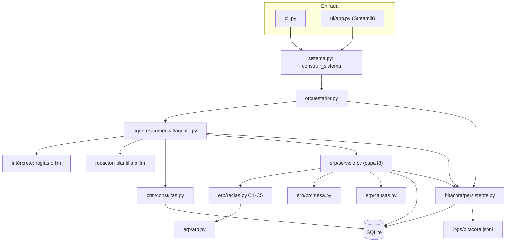
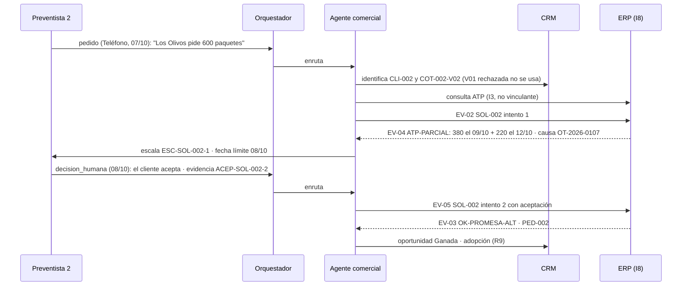

# Vistas de arquitectura · Agente SIE v4.0 (PC3)

Complementa `PLAN_PC3.md` §4. Los sistemas SAP, TUALI y AC Móvil están **simulados**: el agente reproduce la frontera CRM–ERP del EP sobre una base SQLite con datos sintéticos.

## 1. Contexto

| Actor o sistema | Rol en el Agente SIE | Real o simulado |
|---|---|---|
| Bodeguero / mayorista | Pide por TUALI, preventa o teléfono | Texto de entrada |
| Preventista | Registra pedidos telefónicos (R8) y la aceptación del cliente (EV-05) | Persona en la demo (decisión humana) |
| CRM (SAP Sales Cloud [SUPUESTO]) | Cliente comercial, oportunidad, cotización, adopción de TUALI | `sie.crm` sobre SQLite |
| Integration Suite (I8) | Intentos, idempotencia, bitácora del contrato | `sie.erp.servicio` (capa I8) |
| ERP (SAP ECC/APO) | Maestros, C1–C5, ATP, promesa, pedido | `sie.erp` sobre SQLite |
| Planeamiento del CD / APO | Plan de reposición afectado por la OT | Tabla `plan_reposicion` |
| Mantenimiento | Orden de trabajo de la línea de llenado | Tablas `activos` y `ordenes_trabajo` |
| Claude API | Interpreta texto y redacta (solo modo `llm`) | Externo y opcional |

## 2. Componentes

## 3. Proceso: excepción prioritaria

El caso normal sigue el mismo camino sin escalamiento: `EV-02 SOL-003 → EV-03 OK-ACEPTADO → PED-003`.

## 4. Datos

Modelo, seed por corte, parada sintética y previsión para la PC4: `PLAN_PC3.md` §5. Tablas nuevas y columnas: `INTERFACES.md` §5. Diccionario completo: `datos/DICCIONARIO.csv` (bloque B).

## 5. Despliegue

| Elemento | En la PC del docente |
|---|---|
| Python 3.11+ | Único requisito para la CLI (`python -m sie ...` desde `producto/`) |
| SQLite | Incluido en Python; la base `datos/sie.db` se regenera desde `datos/seed/` en cada demo |
| Bitácora | `logs/bitacora.jsonl` (se crea al ejecutar) |
| Streamlit | Opcional, para `python -m sie ui` (navegador local, puerto 8501) |
| Claude API | Opcional (`AGENT_MODE=llm` + `ANTHROPIC_API_KEY` en `.env`); sin ella, modo reglas |

## 6. Seguridad y permisos

| Quién | Lee | Escribe | Nunca |
|---|---|---|---|
| Agente comercial | CRM, ATP (I3), causa del faltante | Mensajes EV-02/EV-05, escalamientos, bitácora | Crear pedidos, aprobar descuentos, cambiar maestros, confirmar una promesa sin `decision_humana` |
| LLM (modo `llm`) | Herramientas de lectura | Nada (solo devuelve una intención y un texto) | Enviar mensajes; introducir cifras que no estén en los hechos |
| ERP simulado | Todo | Pedidos, solicitudes, tramos, bitácora | Responder sin código, responsable y siguiente paso |
| Persona responsable | — | Decisión con evidencia | — |

La API key solo se lee de `.env` o del entorno; no entra en `repr()`, en la bitácora ni en el ZIP.
