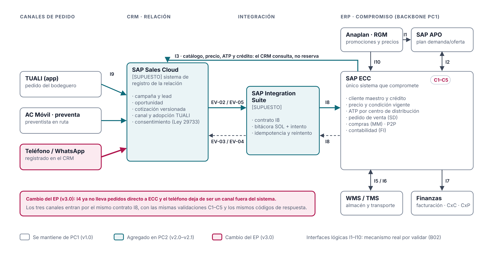

# Arquitectura ERP base · ACL · v3.0 (Examen Parcial)

Gris: se mantiene del PC1. Verde azulado: agregado en la PC2. Granate: cambio del EP.

## Decisión de arquitectura

**SAP ECC/APO sigue siendo el único sistema que compromete** precio, crédito, ATP y pedido [HECHO: decisión PC1 §5.1, 25/09/2026]. SAP Sales Cloud registra la relación con el cliente y el canal por el que pide [SUPUESTO: no hay evidencia pública del CRM de ACL, B13]. SAP Integration Suite lleva el contrato I8, con su bitácora por `id_solicitud + intento` [SUPUESTO].

**Cambio del EP:** los tres canales del canal tradicional (TUALI, preventa en AC Móvil y teléfono/WhatsApp) entran a ECC por el mismo contrato I8. El pedido telefónico ya no se toma a mano: el preventista lo registra en el CRM y pasa por C1–C5 como cualquier otro.

## Por qué esta arquitectura

1. **Continuidad con SAP (criterio C1 del PC1).** Hay evidencia pública de SAP y APO en ACL (S01). Cambiar el backbone no resuelve el problema del canal y agrega riesgo.
2. **Un solo sistema compromete.** Si el CRM o el canal pudieran prometer stock o precio, volvería el problema de H1: promesas sin ATP. La regla de frontera de la S6 lo fija: una oportunidad o una cotización no reservan inventario; el pedido confirmado sí [HECHO: C01, lámina 9].
3. **El CRM sabe por dónde pide cada cliente.** Con `canal_origen` en cada solicitud y `estado_adopcion_tuali` en el cliente se distinguen clientes digitales, híbridos y telefónicos. Así la migración a TUALI se dirige cliente por cliente y se puede medir.
4. **La elección resiste la migración de ECC.** ECC tiene mantenimiento principal hasta fines de 2027 y extendido opcional hasta 2030 [HECHO: F16, acceso 23/10/2026]. SAP documenta el flujo de pedido de Sales Cloud a S/4HANA (F15), así que el contrato se conserva si ACL migra.

## Límites y sistemas de registro

| Objeto | Sistema de registro |
|---|---|
| Campaña, lead, contacto, consentimiento, canal y adopción de TUALI | CRM (SAP Sales Cloud) [SUPUESTO] |
| Oportunidad, cotización versionada (precio, descuento y ATP consultados al ERP) | CRM |
| Solicitud de creación de pedido (bitácora del contrato) | SAP Integration Suite [SUPUESTO] |
| Cliente (identidad fiscal, crédito, dirección), producto, precio, regla de descuento | ERP (SAP ECC) |
| Pedido, ATP, entrega, factura, pago, inventario | ERP (SAP ECC) / WMS-TMS |
| Plan de demanda y oferta, reposición | SAP APO (I2) |
| Promociones y precios propuestos | Anaplan RGM (I1, I10) |

## Interfaces

`interfaces.csv` lista I1–I10 con su cambio por versión. Son una **arquitectura lógica propuesta**, no un inventario productivo: protocolo, frecuencia y volumen siguen pendientes (B02, B14).

## Qué no se decide aquí

No se elige partner, licencias ni presupuesto. No se decide la migración a S/4HANA. No se diseña la ejecución del pedido, la entrega, la facturación ni la posventa.
