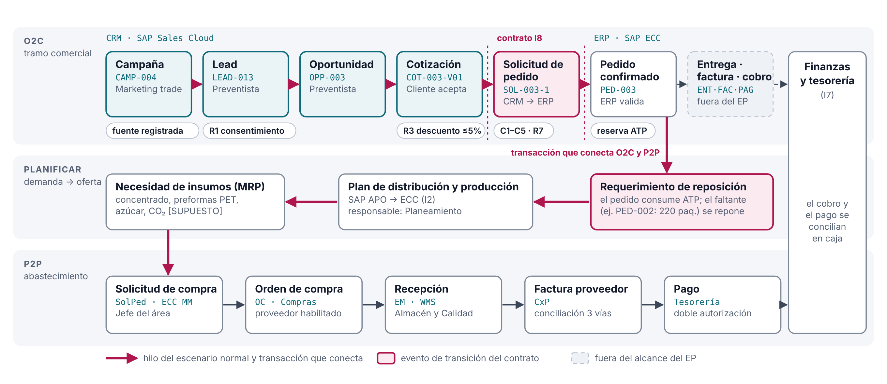

# Mapa integrado O2C–P2P · ACL · v3.0

## Transacción que conecta el recorrido

**El pedido de venta confirmado consume ATP en el CD.** Cuando lo pedido supera lo disponible, el faltante se convierte en un requerimiento de reposición. SAP APO lo traduce en un plan de distribución y producción (I2) y, si la planta no tiene producto o insumos, el MRP genera la necesidad de compra que inicia P2P.

En los datos de prueba: SOL-002 pide 600 paquetes de PRD-001 y el ATP es 380 (validador §4: 402 − 22). PED-002 queda con 220 paquetes en reposición desde planta, previstos para el 12/10 (`Inventario_actual`, `Movimientos_inventario`). Esa reposición es el punto donde O2C deja de ser solo comercial y pasa a depender de abastecimiento [HECHO para el modelo; el flujo APO → MRP → compra es SUPUESTO].

Hay un segundo punto de encuentro, el financiero: el cobro de O2C y el pago de P2P se concilian en tesorería (I7).

## Hilo O2C del escenario normal (Bodega Don Lucho)

| # | Evento / estado | Responsable | Dato o documento | Regla o control | Sistema |
|---|---|---|---|---|---|
| 1 | Campaña activa: "Pásate a TUALI", bono de 2 % en el primer pedido por la app | Marketing trade | CAMP-004 | Campaña con fuente y vigencia | CRM |
| 2 | Lead calificado (30/09): visita con demostración, el cliente acepta probar la app | Preventista 1 | LEAD-013 | R1: en ruta, con smartphone y consentimiento para WhatsApp (Ley 29733) | CRM (I9) |
| 3 | Oportunidad ganada: primer pedido por TUALI | Preventista 1 | OPP-003 | — | CRM |
| 4 | Cotización aceptada en TUALI (01/10): 65 paquetes, 5 % (3 % promoción + 2 % bono), S/ 1,589.02 con IGV | Cliente · Preventista 1 | COT-003-V01 | R2 solo versión aceptada; R3 hasta 5 % sin aprobación | CRM; precio y ATP consultados al ERP (I3) |
| 5 | Solicitud de creación de pedido (02/10), `canal_origen = TUALI` | CRM → ERP | SOL-003 intento 1 (EV-02) | C1–C5; R7 idempotencia | Integration Suite (I8) |
| 6 | Pedido confirmado, promesa 03/10 | ERP · Preventista 1 | PED-003 · `OK-ACEPTADO` (EV-03) | Reserva de ATP | SAP ECC |
| 7 | Entrega, factura y cobro | Operaciones · Finanzas | ENT-003 · FAC-003 · PAG-002 | Fuera del alcance del EP | SAP ECC · WMS/TMS |

## Tramo de planificación y P2P

| Paso | Evento | Responsable | Control y riesgo que previene | Fuente |
|---|---|---|---|---|
| Planificar | Requerimiento de reposición del CD; plan de distribución y producción en APO (I2) | Planeamiento | Prioridad de la promoción frente a la capacidad | SUPUESTO; PC1 I2 |
| Planificar | Necesidad de insumos (MRP): concentrado, preformas PET, azúcar, CO₂ | Planeamiento de materiales | Cobertura de insumos contra el plan | SUPUESTO (S2 del avance S5) |
| P2P | Solicitud de compra aprobada → orden de compra | Jefe del área · Compras | Presupuesto y proveedor habilitado; segregación entre quien pide, compra y aprueba | Avance S5, matriz P2P |
| P2P | Recepción del bien (entrada de mercancías) | Almacén · Calidad | Evidencia de recepción y tolerancias: no pagar lo no recibido | Avance S5, matriz P2P |
| P2P | Factura de proveedor y pago | Cuentas por pagar · Tesorería | Conciliación de tres vías y doble autorización: no pagar duplicado ni a cuenta errada | Avance S5, matriz P2P |

## Límites

- Entrega, facturación y cobro aparecen solo como continuidad del hilo; no se evalúan en el EP.
- P2P se presenta a nivel de mapa; los insumos, responsables y tiempos son supuestos y no datos de ACL.
- El vínculo APO → MRP → compra es la lógica estándar de un ERP integrado; su configuración real en ACL no se ha verificado (B01, B05).
