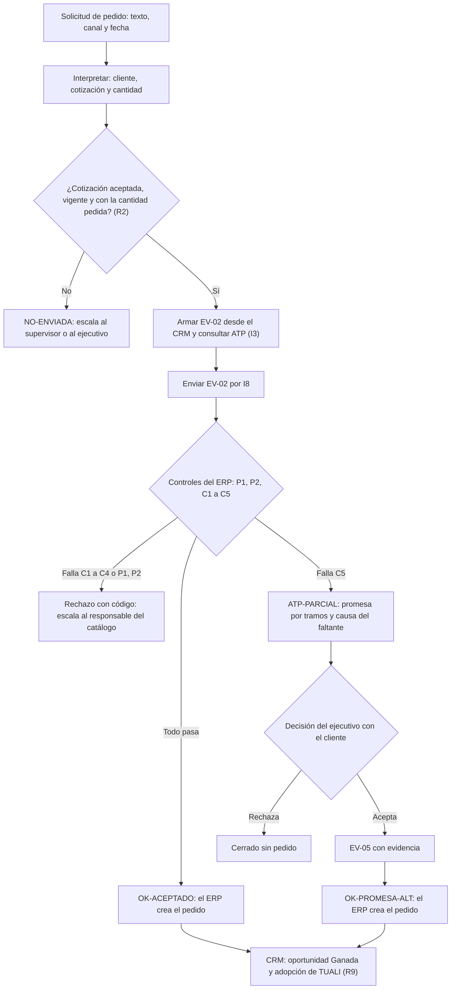

# Modelo del proceso: solicitud de pedido con el agente comercial

Cada caja deja una entrada en la bitácora. El modelo de datos está en `arquitectura/PLAN_PC3.md` §5 y la tabla de decisiones en `REGLAS.md`.
